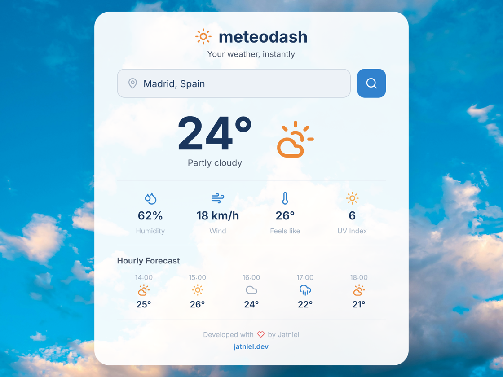

# MeteoDash

[](https://github.com/jatniel/MeteoDash/actions/workflows/ci.yml)


A simple weather dashboard built with **Symfony 8** and the **OpenWeatherMap API**.

Created by **Jatniel Guzmán** - [jatniel.dev](https://jatniel.dev)

Built for the [DevChallenges - Week 15](https://devchallenges.yoandev.co/challenge/2026-week-15/) organized by **[YoanDev](https://github.com/yoanbernabeu)**.

<p align="center">
  
</p>

> **Live demo (temporary):** [meteodash.jatniel.dev](https://meteodash.jatniel.dev)

---

## Features

- Search weather by city name
- Current temperature, description and line icons (inline SVG)
- Readings: feels like, humidity, wind (km/h + direction), pressure, visibility
- 3-hour forecast (next 5 slots)
- Calm "living sky" design: the page tint follows the weather and day or night, French UI, fluid from 320 px to 4K
- Temperature curve for the next 15 hours, drawn in inline SVG
- No external JS dependencies - vanilla JavaScript

---

## How it works

The user types a city name. The frontend sends an AJAX request to the Symfony backend, which calls the OpenWeatherMap API and returns weather data as JSON.

```
Browser (weather.js)
  → POST /api/weather  { "city": "..." }
    → WeatherController::apiWeather()
      → WeatherService::getWeather()    → OpenWeatherMap /data/2.5/weather
      → WeatherService::getForecast()   → OpenWeatherMap /data/2.5/forecast
    ← JSON { current: {...}, forecast: [...] }
  ← DOM update
```

---

## API endpoints

### `GET /`

Renders the weather dashboard page.

### `POST /api/weather`

Returns current weather and forecast as JSON. The city is sent in the JSON body (never in the URL):

```json
{ "city": "Madrid" }
```

The endpoint only accepts same-origin requests (see [Security](#security)), so a call from outside the browser must send the matching headers:

```bash
curl -X POST http://localhost:8000/api/weather \
  -H 'Content-Type: application/json' \
  -H 'Origin: http://localhost:8000' \
  -d '{"city": "Madrid"}'
```

Errors: `400` invalid body or city name, `403` not same-origin, `404` unknown city, `413` body over 1 KB, `415` not `application/json`, `429` rate limit exceeded (with `Retry-After`).

**Example response:**

```json
{
  "current": {
    "city": "Madrid",
    "country": "ES",
    "temperature": 24.5,
    "feels_like": 23.8,
    "description": "partly cloudy",
    "icon": "02d",
    "humidity": 62,
    "wind_speed": 5.1,
    "wind_direction": "NO",
    "visibility": 10000,
    "pressure": 1018
  },
  "forecast": [
    {
      "time": "15:00",
      "temperature": 26.0,
      "description": "clear sky",
      "icon": "01d"
    }
  ]
}
```

**Error response:**

```json
{ "error": "Ville introuvable." }
```

---

## Security

- The city never appears in a URL (no query string, no history entry): it is sent in a `POST` JSON body.
- `POST /api/weather` requires `Content-Type: application/json`, a body of at most 1 KB, and a city of 2 to 100 characters (letters, combining marks, spaces, apostrophes, hyphens, dots, commas).
- Same-origin check: `Sec-Fetch-Site` must be `same-origin` and `Origin`, if sent, must match the site; at least one of the two is required. Combined with the JSON content type (which forces a CORS preflight that is never answered), this blocks CSRF and use of the API key by other sites.
- Rate limiting (strict, anti-spam; `config/packages/rate_limiter.yaml`), checked in this order after the origin check: `weather_burst` (token bucket, 3 searches per client IP then 1 every 5 s), `weather_daily_ip` (50 per IP per day) and `weather_daily_global` (300 per day for all visitors, protects the OpenWeatherMap quota). A refused request gets `429`, a French message and `Retry-After`. The frontend also ignores new searches while one is in flight, does not re-request the city already shown, and pauses searching for the `Retry-After` delay after a short `429`.
- Error messages are generic and in French; upstream details are never exposed. API responses are sent with `Cache-Control: no-store`.
- HTML responses carry a nonce-based Content-Security-Policy (no `unsafe-inline`), `X-Content-Type-Options`, `Referrer-Policy`, `X-Frame-Options: DENY`, `Permissions-Policy`, `Cross-Origin-Opener-Policy`, and HSTS on HTTPS requests (`src/EventListener/SecurityHeadersListener.php`).
- Behind a reverse proxy, configure Symfony's trusted proxies so the client IP (rate limit) and scheme (origin check) are read correctly.

---

## Project structure

```
meteodash/
├── assets/
│   ├── app.js                    # JS entry point
│   ├── weather.js                # AJAX logic & DOM updates
│   ├── curve.js                  # Temperature curve (inline SVG)
│   ├── icons.js                  # Weather line icons
│   └── styles/
│       ├── app.css               # Global layout, CSS variables, responsive
│       └── weather.css           # Dashboard component styles
├── config/
│   ├── packages/                 # Symfony bundle configs
│   └── services.yaml             # Service autowiring
├── public/
│   └── index.php                 # Front controller
├── src/
│   ├── Controller/
│   │   └── WeatherController.php # Routes: / and POST /api/weather
│   ├── DTO/
│   │   ├── WeatherData.php       # Current weather value object
│   │   └── HourlyForecastData.php# Forecast entry value object
│   └── Service/
│       └── WeatherService.php    # OpenWeatherMap API client
├── templates/
│   ├── base.html.twig            # Base HTML layout
│   └── weather/
│       └── index.html.twig       # Dashboard page
├── .env                          # Environment variables
├── composer.json
└── importmap.php                 # Asset Mapper config
```

---

## Design decisions

| Choice | Why                                                                          |
|--------|------------------------------------------------------------------------------|
| `final readonly` DTOs | Immutability - data cannot be altered after creation                         |
| `JsonSerializable` on DTOs | The DTO controls its own JSON shape, keeping the controller thin             |
| `#[Autowire(env:)]` | Self-describing service - no manual wiring in `services.yaml`                |
| Constructor injection | Explicit dependencies, easier to test                                        |
| `ExceptionInterface` catch | Only catches HTTP client errors - unexpected bugs are not silently swallowed |
| Asset Mapper | Symfony-native asset management - no Node.js, no Webpack, no build step      |
| CSS custom properties | Single source for colors and sizing, easy to maintain                        |
| `em` units in components | All elements scale proportionally with the base font size                    |

---

## Setup

### Requirements

- PHP 8.4+
- Composer
- Symfony CLI (optional, for local server)

### Installation

```bash
git clone <repository-url>
cd meteodash
composer install
```

### API Key

This app uses the [OpenWeatherMap API](https://openweathermap.org/). You need a free API key:

1. Create an account at [openweathermap.org](https://openweathermap.org/)
2. Go to **API keys** in your profile and copy your key
3. Create a `.env.local` file at the project root:

```env
OPENWEATHERMAP_API_KEY=your_api_key_here
```

### Run

```bash
symfony server:start
```

Then open [http://localhost:8000](http://localhost:8000).

---

## Production deployment (Apache / shared hosting)

### Requirements

- PHP 8.4+
- Composer
- Apache with `mod_rewrite` enabled

### Steps

**1. Clone and install dependencies (no dev)**

```bash
git clone <repository-url>
cd meteodash
composer install --no-dev --optimize-autoloader
```

**2. Create `.env.local`** at the project root with your real values:

```env
APP_ENV=prod
APP_SECRET=your_secret_here        # generate with: openssl rand -hex 32
OPENWEATHERMAP_API_KEY=your_key_here
WEATHER_LANG=fr
WEATHER_UNITS=metric
```

**3. Compile assets**

```bash
php bin/console asset-map:compile
```

This dumps all CSS/JS into `public/assets/` as static files.

**4. Warm up the cache**

```bash
php bin/console cache:clear --env=prod
```

**5. Set the document root** to the `public/` folder in your hosting control panel.

**6. Apache `.htaccess`**

The file `public/.htaccess` (included via `symfony/apache-pack`) handles URL rewriting. Make sure Apache has `AllowOverride All` enabled for the directory, otherwise routing will not work.

### Notes

- Never commit `.env.local` — it contains secrets.
- The `var/` directory must be writable by the web server.
- Weather results are cached for 10 minutes using the filesystem cache (`var/cache/`).

---

## Tests

5 tests, 23 assertions - no API key needed to run them.

```bash
vendor/bin/phpunit
```

| Test | Type | What it verifies |
|------|------|------------------|
| `WeatherServiceTest::testGetWeatherReturnsCorrectDto` | Unit | API response → WeatherData mapping (all fields) |
| `WeatherServiceTest::testGetForecastReturnsLimitedEntries` | Unit | API response → HourlyForecastData[] with correct limit and city-local times |
| `WeatherControllerTest::testHomePageRendersSuccessfully` | Functional | `GET /` returns 200 and renders the page |
| `WeatherControllerTest::testApiRejectsTooShortCity` | Functional | `GET /api/weather/a` returns 400 with error message |
| `WeatherControllerTest::testApiReturnsNotFoundWhenCityIsUnknown` | Functional | Upstream 404 is mapped to `404 City not found.` (HTTP mocked) |

Unit tests use Symfony's `MockHttpClient` - they mock the HTTP layer, so **no real API calls are made and no API key is required**.

Functional tests boot the Symfony kernel in `test` environment. The `.env.test` file provides a dummy API key for service injection.

Configuration: [`phpunit.xml.dist`](phpunit.xml.dist)

---

## Code quality

The project uses two tools to ensure code quality:

### PHP-CS-Fixer - Code formatting

Enforces Symfony coding standards automatically.

```bash
# Check for issues (dry run)
vendor/bin/php-cs-fixer fix --dry-run --diff

# Fix all files
vendor/bin/php-cs-fixer fix
```

Configuration: [`.php-cs-fixer.dist.php`](.php-cs-fixer.dist.php)

### PHPStan - Static analysis

Detects type errors and bugs without running the code. Configured at **level 6**.

```bash
vendor/bin/phpstan analyse
```

Configuration: [`phpstan.dist.neon`](phpstan.dist.neon)

---

## Tech stack

- **Symfony 8.0** - PHP framework
- **PHP 8.4** - Readonly classes, typed properties, named arguments
- **Asset Mapper** - Native CSS/JS management (no Node.js)
- **OpenWeatherMap API** - Weather data provider
- **Vanilla JS** - No frontend framework

---

## License

MIT - See [LICENSE](LICENSE) for details.
